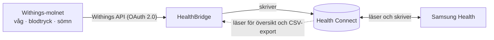

# HealthBridge

**En egen Android-app som för över din Withings-data till Samsung Health via Health Connect.**
Ett hobbyprojekt som ersätter Health Sync för flödet *Withings → Samsung Health* på en
Samsung Galaxy S24 Ultra, men den fungerar på alla telefoner med Android 9 eller senare och Health Connect.

<p align="center">
  
  
  
  
</p>

<sub>Skärmdumparna är från emulatorn med påhittade värden.</sub>

## Så fungerar det



HealthBridge hämtar dina mätningar från Withings och skriver in dem i Health Connect, Androids
gemensamma lager för hälsodata. Samsung Health läser dem därifrån, precis som allt annat som
finns i Health Connect. Ingen server behövs. Allt körs på telefonen och appen pratar bara med
Withings eget API.

- **Automatisk synk i bakgrunden**, varje 1–24 timme. Det går också att synka direkt med *Synka nu*.
- **Inga dubbletter.** Varje värde får ett fast ID (t.ex. `withings:meas:<grpid>:weight`). Om samma
  data synkas igen, eller om du rättar ett värde i Withings, uppdateras posten i stället för att dubbleras.
- **Säger till när något är fel.** Om Withings slutar godta inloggningen får du en avisering och en
  knapp för att logga in igen. Synken fortsätter sedan där den slutade.
- **Översikt och export.** Visar senaste värdena per källa (Samsung Health, Withings eller alla)
  och kan exportera 30 dagars data som CSV.
- **Krypterade nycklar.** Withings-nycklarna och Client Secret krypteras med en nyckel som ligger
  kvar i telefonens Android Keystore.

### Vad som synkas

| Från Withings | Till Health Connect |
|---|---|
| Vikt, längd | `Weight`, `Height` |
| Fettprocent, fettfri massa, benmassa, vatten | `BodyFat`, `LeanBodyMass`, `BoneMass`, `BodyWaterMass` |
| Basalmetabolism (BMR) | `BasalMetabolicRate` |
| Blodtryck och puls | `BloodPressure`, `HeartRate` |
| Syremättnad, kroppstemperatur, VO₂ max | `OxygenSaturation`, `BodyTemperature`, `Vo2Max` |
| Sömn med faser (vaken/lätt/djup/REM) | `SleepSession` med stadier |
| Steg, distans och kalorier från en Withings-klocka *(avstängt som standard)* | `Steps`, `Distance`, `ActiveCaloriesBurned`, `TotalCaloriesBurned` |

Steg är avstängt som standard, eftersom telefonen och Galaxy Watch redan räknar steg i Samsung
Health. Slår du på det synkas bara steg från en Withings-tracker, så att steg som Withings
själv hämtat från telefonen inte skrivs tillbaka.

## Kom igång

### 1. Skapa en Withings-utvecklarapp (en gång)

1. Logga in på [developer.withings.com](https://developer.withings.com/dashboard/) och skapa en ny
   applikation (*Public API*, gratis).
2. Ange **Callback URL** `https://example.com/`. Appen fångar omdirigeringen innan sidan laddas,
   så adressen behöver inte vara din egen. Den bör ändå svara med HTTP 200, eftersom Withings kan
   testa att den går att nå. Det gör `example.com/` men inte `example.com/något`.
3. Kopiera **Client ID** och **Client Secret**.

Uppgifterna skrivs in i appen under *Inställningar*. Du kan också lägga dem i `local.properties`
innan du bygger, så är de förifyllda:

```properties
withings.clientId=...
withings.clientSecret=...
withings.redirectUri=https://example.com/
```

### 2. Bygg och installera

Slå på utvecklarläget på telefonen: *Inställningar → Om telefonen → Programvaruinformation*,
tryck 7 gånger på *Byggnummer*. Slå sedan på *Utvecklaralternativ → USB-felsökning*. Anslut
telefonen och kör:

```powershell
powershell -ExecutionPolicy Bypass -File .\build-and-install.ps1
```

Skriptet bygger, installerar och startar appen. Utan ansluten telefon skrivs sökvägen till
`app\build\outputs\apk\debug\app-debug.apk` ut. Den filen kan du också kopiera till telefonen och
installera för hand.

Bygget kräver JDK 17 eller senare och Android SDK (compileSdk 37). Projektet går också att
öppna direkt i Android Studio.

### 3. I appen

1. **Inställningar:** fyll i Client ID, Client Secret och Callback-URL och tryck *Spara*.
2. **Hem → Ge behörigheter** (Health Connect).
3. **Hem → Logga in på Withings.** Första synken startar direkt och hämtar 30 dagars historik.
   Det ändrar du under *Historik att hämta*.
4. **Hem → Bakgrundskörning → Tillåt.** One UI söver appar som körs i bakgrunden, och då stannar
   synken. Tillåt också aviseringar när appen frågar.
5. **Samsung Health → Inställningar → Health Connect:** låt Samsung Health läsa vikt, kroppsfett,
   blodtryck, sömn och så vidare.
6. Stäng av motsvarande synk i Health Sync när du har jämfört, annars får du dubbla värden.

Loggar du in på Withings med Google eller Apple kan den inbäddade inloggningen blockeras. Använd då
*Logga in via webbläsaren* under Inställningar och klistra in adressen du hamnar på. Koden i den
gäller bara i ungefär 30 sekunder.

## När något går fel

<p>
  
</p>

Tillfälliga fel, som att telefonen saknar nät eller att Withings svarar *för många anrop*, hanteras
utan att du märker något. Synken försöker igen senare.

Om Withings slutar godta inloggningen, till exempel för att du tagit bort åtkomsten i
Withings-appen, visar hemskärmen *Logga in igen* och du får en avisering:


Fliken *Logg* visar varje körning: vad som skrevs, vad som hoppades över och varför.

- **Gav du en behörighet i efterhand eller ändrade historikperioden?** Välj *Hämta om historik*
  under Inställningar. Redan skrivna värden uppdateras och dubbleras inte.
- **Synkar den inte i bakgrunden?** Kontrollera att HealthBridge har *Obegränsad* batterianvändning
  (*Inställningar → Appar → HealthBridge → Batteri*) och inte ligger bland *Sovande appar*.

<br clear="right">

## Begränsningar

- **Bara åt ett håll.** Withings publika API tillåter inte att man skriver data *till* Withings,
  så Samsung Health → Withings går inte att bygga.
- **Hämtning, inte push.** Withings rekommenderar webhooks, men de kräver en publik server. Appen
  frågar i stället Withings med jämna mellanrum, högst en gång i timmen som standard.
- **Inte testad mot ett riktigt Withings-konto än.** Hela synkflödet är testat i emulatorn mot en
  låtsas-Withings-server och riktiga Health Connect. Inloggningen och felhanteringen är testade
  mot Withings riktiga server, men med påhittade uppgifter.

## Utveckling

Kotlin och Jetpack Compose (Material 3, dynamiska färger), AGP 9.4, Gradle 9.8, Health Connect 1.1.0,
WorkManager, DataStore och OkHttp. `minSdk 28`, `targetSdk 36`.

```
app/src/main/java/se/healthbridge/app/
├── withings/       WithingsApi (OAuth + mätningar/aktivitet/sömn), parser, modeller
├── healthconnect/  HealthConnectRepository (skriv/läs/exportera), WithingsRecordMapper
├── sync/           SyncEngine, SyncWorker, SyncScheduler, SyncNotifier
├── data/           Inställningar (DataStore), krypterade hemligheter, synklogg
└── ui/             Hem, Data, Logg, Inställningar, Withings-inloggning (WebView)
```

**Tester**

- Enhetstester: `.\gradlew.bat :app:testDebugUnitTest`. De täcker Withings-parsning, OAuth-redirect
  och mappning till Health Connect-poster, inklusive tidszoner, intervallgränser och sömnfaser.
- Instrumenterade tester: `.\gradlew.bat :app:connectedDebugAndroidTest`. `SyncEngineInstrumentedTest`
  kör hela synken mot en falsk Withings-server och riktiga Health Connect. Det täcker förnyelse av
  nycklar, skrivning, uppdatering utan dubbletter, översikt och CSV, samt att en avvisad inloggning
  ger *Logga in igen*. Testerna körs bara på en emulator, eftersom de skriver över appens
  inställningar. Ge appen alla behörigheter först.
- Om Hyper-V har reserverat emulatorns standardportar (5554–5585) startar den inte. Ange då en
  annan port: `emulator -avd <namn> -port 5640`. Saknar emulatorn DNS, lägg till `-dns-server 8.8.8.8`.

---

HealthBridge är ett privat hobbyprojekt och har ingen koppling till Withings, Samsung eller Google.
Det är inte en medicinteknisk produkt.
