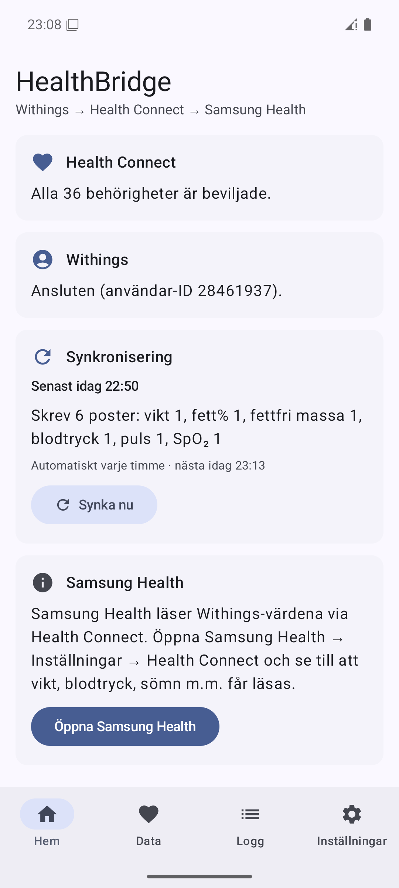
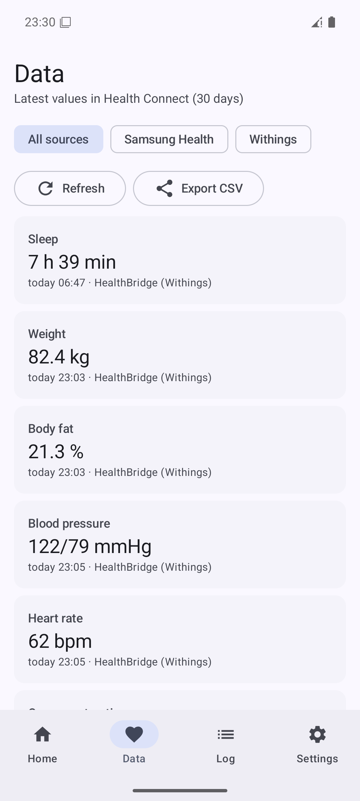
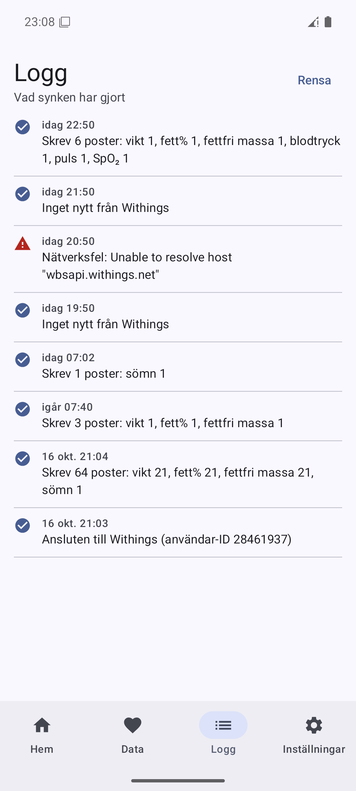
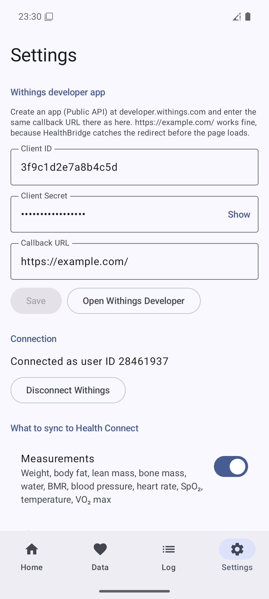
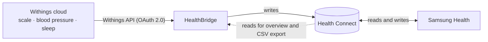
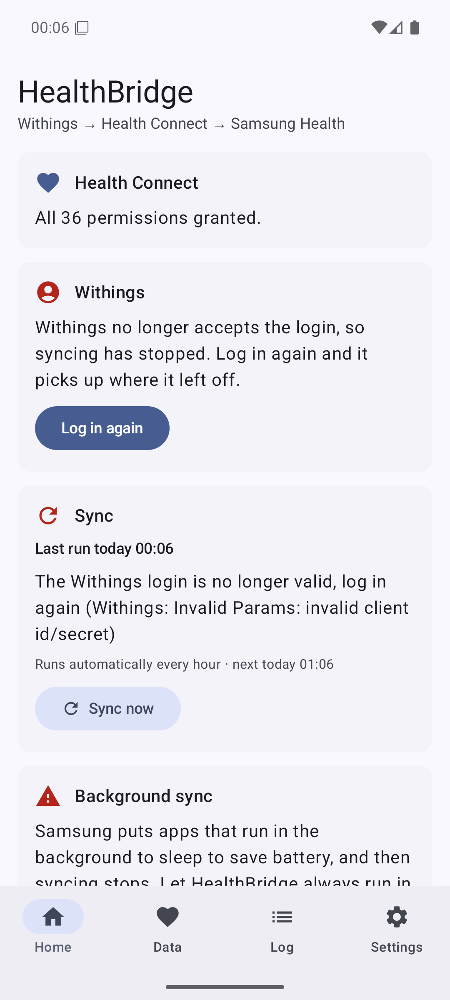
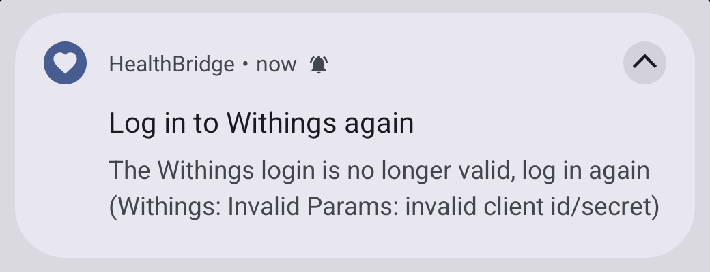

# HealthBridge

[](https://github.com/Mad-Mange/HealthBridge/actions/workflows/ci.yml)
[](https://github.com/Mad-Mange/HealthBridge/releases/latest)

**A small Android app that moves your Withings data into Samsung Health through Health Connect.**
It's a hobby project that replaces Health Sync for the *Withings → Samsung Health* flow on a
Samsung Galaxy S24 Ultra, but it works on any phone with Android 9 or later and Health Connect.

<p align="center">
  
  
  
  
</p>

<sub>Screenshots are from the emulator with made-up values. The app is in English and Swedish and follows the
phone's language.</sub>

## How it works



HealthBridge fetches your measurements from Withings and writes them to Health Connect, Android's
shared store for health data. Samsung Health reads them from there, like everything else in Health
Connect. There is no server: everything runs on the phone, and the app only talks to Withings' own API.

- **Automatic background sync** every 1–24 hours, plus *Sync now*.
- **No duplicates.** Every value gets a stable ID (e.g. `withings:meas:<grpid>:weight`). Syncing the
  same data again, or correcting a value in Withings, updates the record instead of adding a new one.
- **Deleted in Withings, deleted here.** A measurement from the last 30 days that you delete in
  Withings, or assign to another user, is also removed from Health Connect.
- **Only your own weigh-ins.** When a shared scale can't tell who stepped on it, Withings asks you to
  confirm the measurement in its app. HealthBridge waits until you have, so a guest's weight never
  ends up in Samsung Health.
- **Tells you when something is wrong.** If Withings stops accepting the login you get a notification
  and a button to log in again, and the sync then picks up where it left off.
- **Overview and export.** Shows the latest values per source (Samsung Health, Withings or all) and
  exports 30 days of data as CSV.
- **Encrypted keys.** The Withings tokens and the client secret are encrypted with a key that stays
  in the phone's Android Keystore.

### What gets synced

| From Withings | To Health Connect |
|---|---|
| Weight, height | `Weight`, `Height` |
| Body fat, lean mass, bone mass, body water | `BodyFat`, `LeanBodyMass`, `BoneMass`, `BodyWaterMass` |
| Basal metabolic rate (BMR) | `BasalMetabolicRate` |
| Blood pressure and heart rate | `BloodPressure`, `HeartRate` |
| Oxygen saturation, body temperature, VO₂ max | `OxygenSaturation`, `BodyTemperature`, `Vo2Max` |
| Sleep with stages (awake/light/deep/REM) | `SleepSession` with stages |
| Steps, distance and calories from a Withings watch *(off by default)* | `Steps`, `Distance`, `ActiveCaloriesBurned`, `TotalCaloriesBurned` |

Steps are off by default because the phone and Galaxy Watch already count steps in Samsung Health.
If you turn them on, only steps from a Withings tracker are synced, so steps that Withings itself
collected from the phone aren't written back.

## Getting started

### 1. Create a Withings developer app (once)

1. Log in at [developer.withings.com](https://developer.withings.com/dashboard/) and create a new
   application (*Public API*, free).
2. Set the **Callback URL** to `https://example.com/`. The app catches the redirect before the page
   loads, so the address doesn't have to be yours. It should still answer HTTP 200, because Withings
   may check that it's reachable. `example.com/` does, `example.com/anything` doesn't.
3. Copy the **Client ID** and **Client Secret**.

Enter them in the app under *Settings*, or put them in `local.properties` before building to have
them pre-filled:

```properties
withings.clientId=...
withings.clientSecret=...
withings.redirectUri=https://example.com/
```

### 2. Install the app

**From GitHub (easiest).** On the phone, open
[the latest release](https://github.com/Mad-Mange/HealthBridge/releases/latest) and download
`HealthBridge-<version>.apk`. Open the downloaded file and allow your browser to install unknown
apps when Android asks. On a Samsung phone:

- If the install is blocked outright, turn off *Settings → Security and privacy → Auto Blocker*
  while you install, and turn it back on afterwards.
- If Play Protect warns about an unknown app, choose *More details → Install anyway*.

New versions install over the old one the same way, and your login and settings are kept.

**Or build it yourself.** Turn on developer mode on the phone: *Settings → About phone → Software
information*, tap *Build number* 7 times. Then turn on *Developer options → USB debugging*. Connect
the phone and run:

```powershell
powershell -ExecutionPolicy Bypass -File .\build-and-install.ps1
```

The script builds, installs and starts the app. Without a connected phone it prints the path to the
APK, which you can also copy to the phone and install by hand. Without the release key (see
[Releases](#releases)) it builds a debug version signed with your computer's debug key. That can't
install over the version from GitHub, or the other way round, without uninstalling first.

Building needs JDK 17 or later and the Android SDK (compileSdk 37). The project also opens directly
in Android Studio.

### 3. In the app

1. **Settings:** enter Client ID, Client Secret and callback URL and tap *Save*.
2. **Home → Grant permissions** (Health Connect).
3. **Home → Log in to Withings.** The first sync starts right away and fetches 30 days of history
   (change it under *History to fetch*).
4. **Home → Background sync → Allow.** One UI puts background apps to sleep, which stops the sync.
   Also allow notifications when the app asks.
5. **Samsung Health → Settings → Health Connect:** let Samsung Health read weight, body fat, blood
   pressure, sleep and so on.
6. Turn off the matching sync in Health Sync once you've compared, or you'll get every value twice.

If you log in to Withings with Google or Apple, the embedded login may be blocked. Use
*Log in through the browser* under Settings and paste the address you end up on. The code in it is
only valid for about 30 seconds.

## When something goes wrong

<p>
  
</p>

Temporary problems, such as no network or Withings answering *too many requests*, are handled
silently. The sync just tries again later.

If Withings stops accepting the login, for example because you removed the access in the Withings
app, the home screen shows *Log in again* and you get a notification:



The *Log* tab lists every run: what was written, what was skipped and why.

- **Granted a permission later or changed the history period?** Choose *Refetch history* under
  Settings. Values that were already written are updated, not duplicated.
- **Not syncing in the background?** Check that HealthBridge has *Unrestricted* battery use
  (*Settings → Apps → HealthBridge → Battery*) and isn't listed under *Sleeping apps*.

<br clear="right">

## Limitations

- **One direction only.** The Withings public API doesn't allow writing data *to* Withings, so
  Samsung Health → Withings can't be built.
- **Polling, not push.** Withings recommends webhooks, but they need a public server. The app polls
  Withings instead, at most once an hour by default.
- **Deletions only for measurements.** Withings' API doesn't report deletions, so HealthBridge
  compares the last 30 days of measurements (weight, blood pressure and so on) on every run.
  Sleep and steps you delete in Withings stay in Health Connect; remove them there if needed.
- **Not tested against a real Withings account yet.** The whole sync flow is tested in the emulator
  against a fake Withings server and the real Health Connect. Login and error handling are tested
  against Withings' real server, but with made-up credentials.

## Development

Kotlin and Jetpack Compose (Material 3, dynamic colours), AGP 9.4, Gradle 9.8, Health Connect 1.1.0,
WorkManager, DataStore and OkHttp. `minSdk 28`, `targetSdk 36`.

```
app/src/main/java/se/healthbridge/app/
├── withings/       WithingsApi (OAuth + measurements/activity/sleep), parser, models
├── healthconnect/  HealthConnectRepository (write/read/export), WithingsRecordMapper
├── sync/           SyncEngine, SyncWorker, SyncScheduler, SyncNotifier
├── data/           Settings (DataStore), encrypted secrets, sync log
└── ui/             Home, Data, Log, Settings, Withings login (WebView)
```

UI text lives in `res/values/strings.xml` (English, the default) and `res/values-sv/strings.xml`
(Swedish). On Android 13 and later you can also pick the app's language under
*Settings → Apps → HealthBridge → Language*.

**Tests**

- Unit tests: `.\gradlew.bat :app:testDebugUnitTest`. They cover Withings parsing, the OAuth redirect,
  the mapping to Health Connect records (time zones, range limits, sleep stages) and which
  measurements to write or remove when Withings' data has changed.
- Instrumented tests: `.\gradlew.bat :app:connectedDebugAndroidTest`. `SyncEngineInstrumentedTest`
  runs a full sync against a fake Withings server and the real Health Connect: token refresh,
  writing, updating without duplicates, removing deleted measurements, holding back unassigned
  ones, overview and CSV, and that a rejected login leads to *Log in again*. They only run on an emulator, because they overwrite the app's settings. Grant the
  app all permissions first.
- If Hyper-V has reserved the emulator's default ports (5554–5585) it won't start. Pick another port:
  `emulator -avd <name> -port 5640`. If the emulator has no DNS, add `-dns-server 8.8.8.8`.
- GitHub Actions runs the unit tests and builds both APKs on every push.

### Releases

Release APKs are signed with a key that never leaves the maintainer's computer. Its location and
passwords go in `local.properties`:

```properties
release.storeFile=C:/Users/<you>/.android/healthbridge-release.jks
release.storePassword=...
release.keyAlias=healthbridge
release.keyPassword=...
```

To publish a version, raise `versionCode` and `versionName` in `app/build.gradle.kts`, commit, and run:

```powershell
powershell -ExecutionPolicy Bypass -File .\release.ps1 [-NotesFile notes.md]
```

The script runs the unit tests, builds and verifies the signed APK, tags `v<versionName>` and
creates the GitHub release with the APK attached. It refuses to run if `local.properties` has
Withings credentials, because they would be built into the public APK. Keep a backup of the key:
without it, a new version can't be installed over the old one.

---

HealthBridge is a personal hobby project and isn't affiliated with Withings, Samsung or Google.
It is not a medical device.
